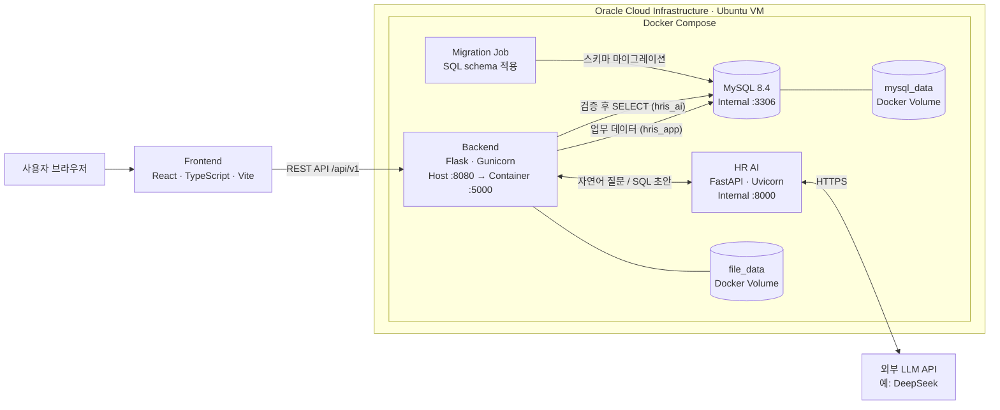
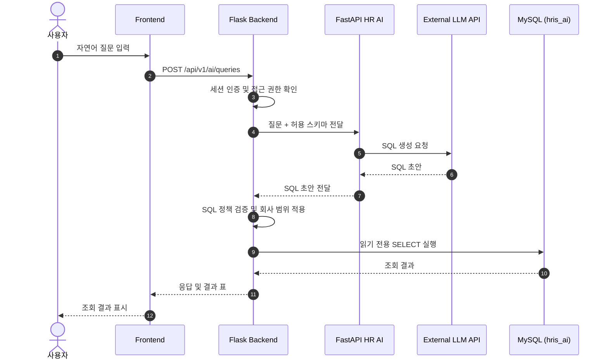
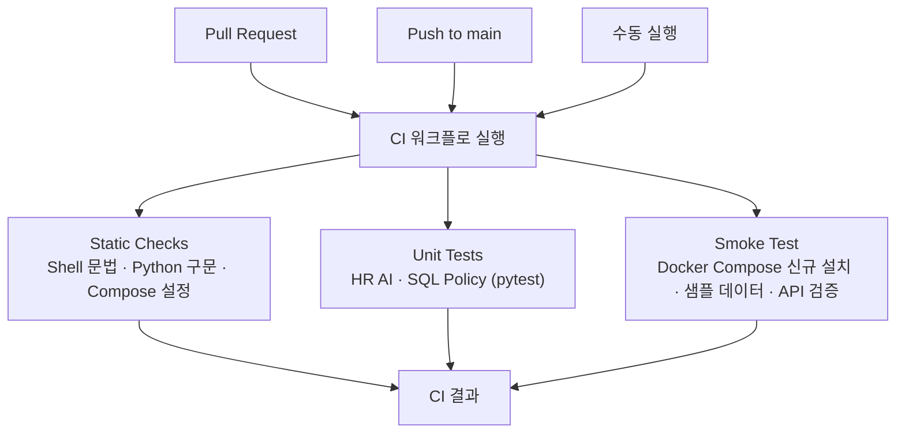
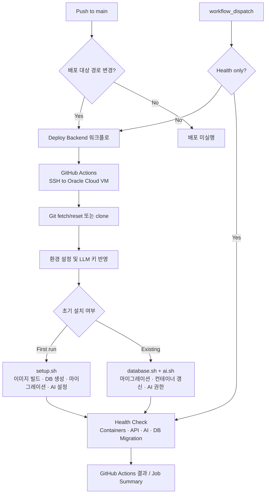

# KNU-DB-HRIS

Human Resource Information System
국립공주대학교 데이터베이스 프로그래밍 Term Project · 2026

KNU-DB-HRIS는 조직·인사·급여·평가·전자결재·문서 업무를 하나의 웹 서비스에서 관리하기 위한 **통합 인적자원관리 시스템(HRIS)** 프로젝트입니다. 자연어 질문으로 인사 데이터를 조회할 수 있는 **HR AI (NL2SQL)** 기능을 포함합니다.

## Team Members

KNU-DB-HRIS는 국립공주대학교 데이터베이스 프로그래밍 Term Project를 위해 구성된 3인 개발팀입니다.

각 구성원은 프로젝트의 설계, 개발 및 통합 과정에 참여하며 협업을 통해 시스템을 완성해 나가고 있습니다.

<table>
  <tr>
    <td align="center" width="25%">
      <a href="https://github.com/ondacloud">
         
        <b>ondacloud</b>
      </a> 
      Backend & Database
    </td>
    <td align="center" width="25%">
      <a href="https://github.com/irnchk">
         
        <b>irnchk</b>
      </a> 
      Frontend & AI
    </td>
    <td align="center" width="25%">
      <a href="https://github.com/hambeau014-design">
         
        <b>hambeau014-design</b>
      </a> 
      Frontend
    </td>
  </tr>
</table>

## 기술 스택 (Tech Stack)

| Layer | Technologies |
| --- | --- |
| Frontend | React, TypeScript, Vite, Lucide React |
| Backend | Python, Flask, Gunicorn, REST API |
| AI | FastAPI, Uvicorn, NL2SQL, External LLM API |
| Database | MySQL 8.4, SQL Views, Stored Procedures, Triggers |
| Infrastructure | Oracle Cloud Infrastructure, Ubuntu, Docker, Docker Compose |
| CI/CD | GitHub Actions, SSH Deployment |

## 프로젝트 저장소 (Repositories)

| Repository | Description |
| --- | --- |
| [Frontend](https://github.com/KNU-DB-HRIS/Frontend) | React 및 TypeScript 기반 웹 애플리케이션 |
| [Backend](https://github.com/KNU-DB-HRIS/Backend) | Flask REST API, HR AI, Docker Compose 및 CI/CD |
| [Database](https://github.com/KNU-DB-HRIS/Database) | MySQL 데이터베이스 스키마 및 마이그레이션 |

## 주요 기능 (Key Features)

| 기능 | 설명 |
| --- | --- |
| 대시보드 | 조직 및 인사 현황, 주요 통계 시각화 |
| 인사 관리 | 직원 등록·수정, 인사발령 및 퇴사 관리 |
| 조직 관리 | 회사·부서·직급·직책·직무 관리 |
| 급여 관리 | 직원별 급여 구성 조회, 변경 등록과 이력 |
| 평가 관리 | 평가 회차, 대상자 및 진행 현황 관리 |
| 전자결재 | 결재 문서 작성, 상신, 승인·반려 |
| 문서 관리 | 재직증명서·급여명세서 등 문서 발급 |
| 일정 | 전사·부서 일정, 사원별 표시 대상 계산 |
| 계정·권한 | 역할 4개(HR 관리자, 인사 담당자, 인사 사원, 사원), 첫 로그인 비밀번호 변경 |
| HR AI | 자연어 질문을 SQL로 변환하여 인사 정보 조회 |

## 시스템 아키텍처 (System Architecture)

### 서버 및 서비스 구성 (Server Architecture)

- **Frontend:** React + TypeScript 기반 사용자 화면
- **Backend:** Flask REST API를 Gunicorn으로 실행합니다.
- **HR AI:** FastAPI 서비스가 자연어로부터 SQL 초안을 생성하며, 서버 호스트에서는 기본적으로 `127.0.0.1:8001`에만 바인딩합니다(컨테이너 내부 `8000`).
- **MySQL:** Compose 네트워크 내에서 접근하며 호스트에 DB 포트를 공개하지 않습니다.
- **Volumes:** `mysql_data`는 DB 데이터, `file_data`는 생성 문서 등의 파일을 보존합니다.
- **Migration:** MySQL 상태 검사 후 일회성 `migrate` 작업으로 SQL 스키마를 적용합니다.

### HR AI 데이터 조회 흐름 (NL2SQL Flow)

> 생성된 SQL을 AI 서비스가 직접 DB에서 실행하지 않습니다. Flask 백엔드에서 SQL을 검증한 뒤 권한이 제한된 `hris_ai` 계정으로 조회합니다.

## 검증 근거 (For Reviewers)

| 확인할 것 | 위치 |
| --- | --- |
| 요구사항 → API → DB → 자동 검사 추적표 | [Database/docs/requirements-trace.md](https://github.com/KNU-DB-HRIS/Database/blob/main/docs/requirements-trace.md) |
| ERD, 데이터 사전, 마이그레이션 `001`~`025` | [Database](https://github.com/KNU-DB-HRIS/Database) (`docs/erd.md`, `docs/data-dictionary.md`) |
| 업무 SQL (API가 실행하는 SQL) | [Backend/app/modules](https://github.com/KNU-DB-HRIS/Backend/tree/main/app/modules) (기능별 `routes.py`, `services.py`) |
| 자동 검사와 최근 결과 | [Backend/tests](https://github.com/KNU-DB-HRIS/Backend/tree/main/tests), [CI 실행 기록](https://github.com/KNU-DB-HRIS/Backend/actions/workflows/ci.yml) |
| NL2SQL 평가 (질문 19개, Simple·보강 프롬프트 비교) | [Backend/ai/eval/results](https://github.com/KNU-DB-HRIS/Backend/tree/main/ai/eval/results) |
| 배포된 서비스 | https://knu-db-hris.vercel.app (가상 샘플 데이터) |

## CI/CD Pipeline

### CI · 코드 검증 (GitHub Actions)

### CD · Oracle Cloud 자동 배포 (GitHub Actions)

- **CI (`ci.yml`):** Pull Request, `main` Push 및 수동 실행 시 정적 검사, HR AI 단위 테스트를 하고, 빈 서버에 새로 설치한 뒤 API 시나리오 검사(스모크, 제안서 요구사항, 기능, 역할 권한, 첫 로그인, 재직 상태·발령 날짜, 프로시저 `CALL`)를 실행합니다.
- **CD (`deploy.yml`):** `main` Push에서 배포 대상 경로가 변경되면 실행되며, 수동 배포 또는 상태만 확인하는 모드도 제공합니다.
- **배포 방식:** 컨테이너 이미지를 별도 레지스트리로 배포하는 방식이 아니라, **Oracle Cloud VM에서 Git 코드를 동기화하고 Docker Compose로 빌드·실행**합니다.
- **배포 검증:** 컨테이너 상태, 백엔드·AI Health API, 최신 DB 마이그레이션 적용 여부를 확인합니다.
- **유의:** 현재 CI와 CD는 별도로 트리거됩니다. CI 성공을 CD의 필수 선행 조건으로 강제하는 파이프라인은 아닙니다.
